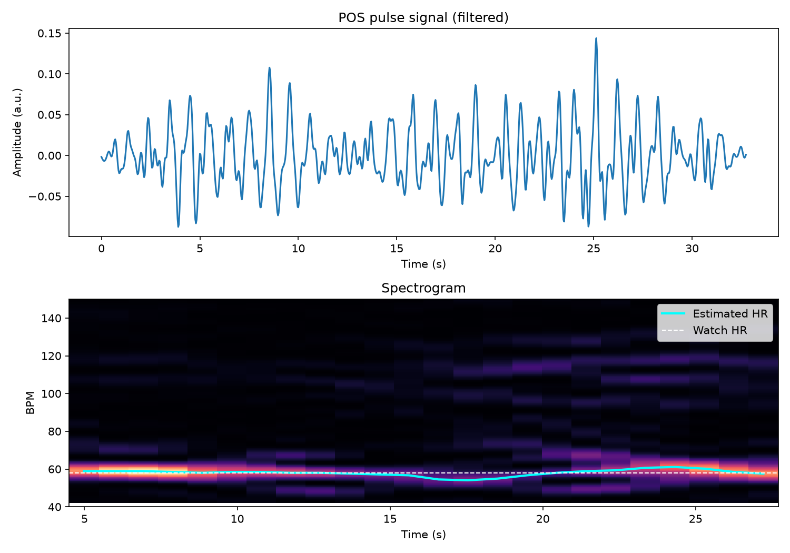
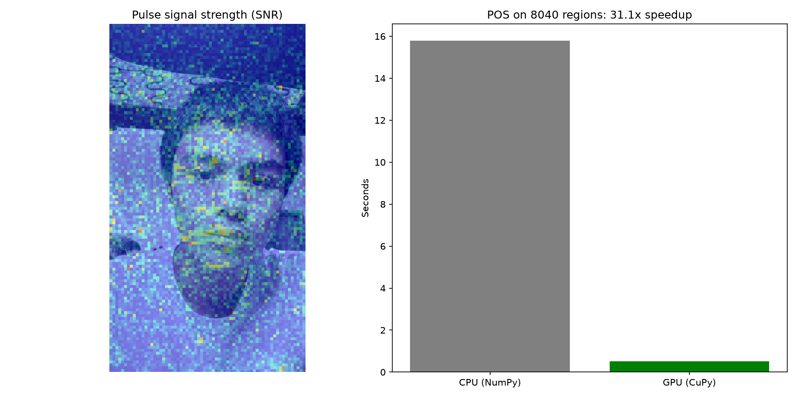

# heartrate-rppg
Estimates heart rate from an iPhone video of a face, with no sensors touching the skin. Implements the **POS (Plane-Orthogonal-to-Skin)** remote photoplethysmography (rPPG) algorithm in Python, then parallelizes it on an NVIDIA GPU with CuPy.

## Results

| Method | Heart rate |
|---|---|
| Smartwatch (ground truth) | 58 BPM |
| PulseCam – single face region (CPU) | 58.6 BPM |
| PulseCam – 8,040 regions, face consensus (GPU) | 58.6 BPM |

| Benchmark: POS on 8,040 regions, 983 frames | Time |
|---|---|
| CPU (NumPy) | 12.25 s |
| GPU (CuPy, RTX 5070 Laptop) | 0.71 s |
| **Speedup** | **17.2×** (identical results, max difference 0.00 BPM) |




## How it works

1. **Physics:** each heartbeat pushes more blood into the skin. Hemoglobin absorbs light (especially green), so skin color changes very slightly (<1%) with every beat.
2. **Signal extraction:** average the RGB values of a skin region in every frame. Averaging thousands of pixels cancels camera noise.
3. **POS algorithm:**
   - Normalize each color channel by its mean, which removes skin tone and brightness.
   - Project onto a plane that cancels changes affecting R, G and B equally (motion, lighting).
   - Combine the two projected signals to suppress the remaining noise.
4. **Bandpass filter:** keep 0.7–4 Hz (42–240 BPM), the range of human heart rates.
5. **FFT:** the strongest frequency in that band × 60 = heart rate in BPM.

### GPU acceleration
Each frame is split into a grid of 16×16-pixel blocks, and POS runs on all 8,040 blocks at once. The blocks are independent, so the work parallelizes well on the GPU. The same function runs on CPU or GPU by swapping NumPy for CuPy. Signal quality (SNR) per block produces a heatmap of where the pulse is strongest, and the final estimate is the median of the best face regions.

## Run it

```bash
pip install opencv-python numpy scipy matplotlib cupy-cuda12x[ctk]
```

Everything is in `heartrate.ipynb`: the single-region pipeline (signal plot and spectrogram), then the all-region POS with the CPU vs. GPU benchmark and SNR heatmap. It runs in Google Colab with a GPU runtime or locally with an NVIDIA GPU.

Set `VIDEO` at the top of the notebook to your own video path. For best results: phone on a stand, locked exposure, steady light, sit still for 30–60 s.

## Limitations

- Tested on a small number of personal recordings, not a benchmark dataset.
- Sensitive to head movement and lighting changes.
- Frequency resolution is limited by video length (~1.8 BPM for a 33 s clip).
- Face region is selected manually.

## Next steps

- Automatic face tracking so the region follows head movement
- Evaluation on a public dataset (UBFC-rPPG)
- Deep learning model (e.g. PhysNet) in PyTorch, compared against the POS baseline
- Real-time processing from a webcam

## Reference

W. Wang, A. C. den Brinker, S. Stuijk, G. de Haan, "Algorithmic Principles of Remote PPG," *IEEE Transactions on Biomedical Engineering*, 2017.
